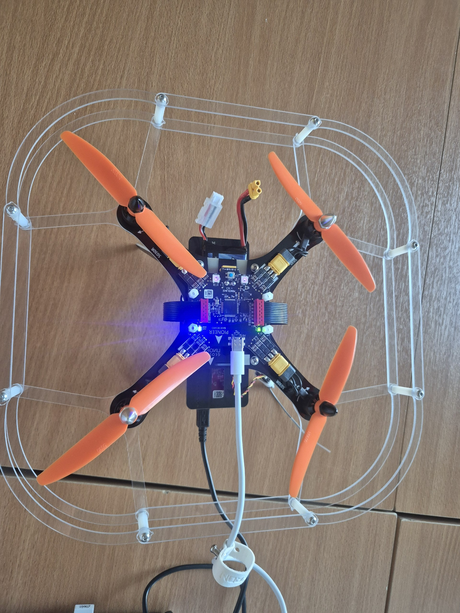
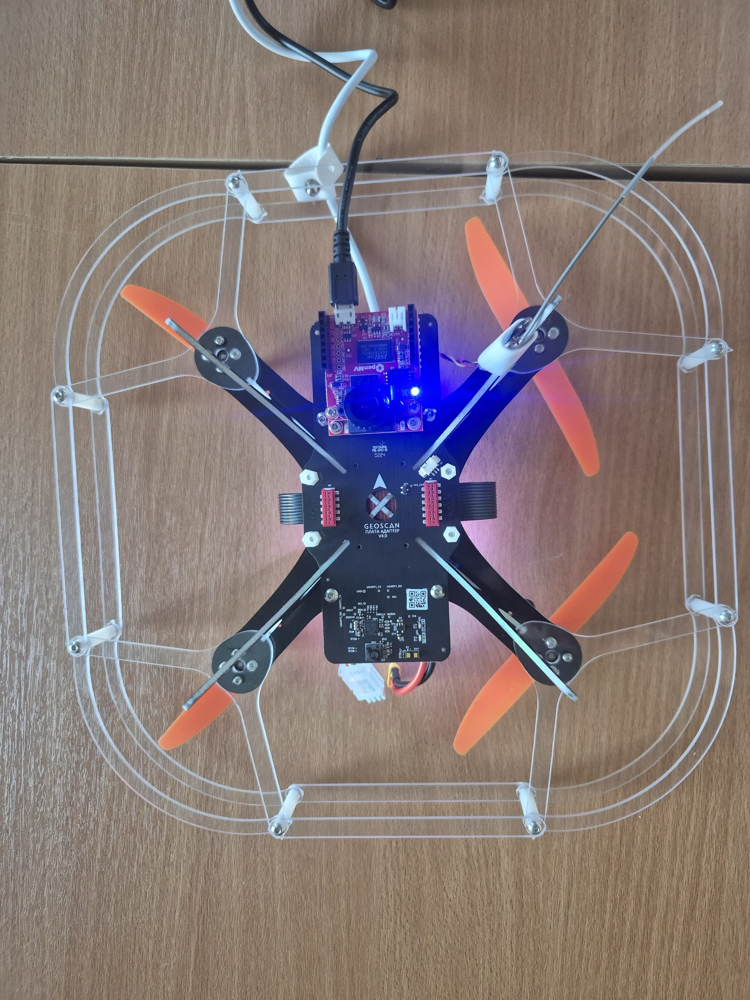

# Первая прошивка БПЛА «Геоскан Пионер»

Инструкция по подготовке полётного контроллера, платы расширения и камеры OpenMV.

## Что потребуется

- БПЛА «Геоскан Пионер»;
- USB-кабели для полётного контроллера и платы расширения;
- установленная **GEOSCAN Pioneer Station** и актуальная прошивка
  автопилота — скачайте их со страницы
  [обновления прошивки Pioneer Station](https://docs.geoscan.ru/pioneer/soft/configure/pio-station-1/firmware-update/);
- актуальная прошивка платы расширения — используйте раздел
  [документации платы расширения](https://docs-beta.geoscan.ru/pioneer/modules/option-board/option-board.html)
  и официальную
  [инструкцию по обновлению загрузчика](https://storage.yandexcloud.net/pioneer-doc.geoscan.ru-static/dwnlds/firmware/fw_base/%D0%9E%D0%B1%D0%BD%D0%BE%D0%B2%D0%BB%D0%B5%D0%BD%D0%B8%D0%B5%20%D0%B7%D0%B0%D0%B3%D1%80%D1%83%D0%B7%D1%87%D0%B8%D0%BA%D0%B0%20%D0%90%D0%9F%201.6.3.pdf);
- файлы в [`fimware/`](./fimware/) — это сохранённые копии прошивок, которые
  использовались при подготовке этого примера;
- установленная **OpenMV IDE** и камера OpenMV — актуальную версию IDE
  скачайте на [официальной странице загрузки OpenMV](https://openmv.io/pages/download);
- скрипты из этого каталога:
  [`led_openmv.py`](./led_openmv.py) и [`led_openmv.lua`](./led_openmv.lua).
  Оба скрипта основаны на примерах из документации производителя [2, 4].

## 0. Сборка и подключение

   1. Соберите БПЛА по инструкции производителя. Установите модуль OpenMV
      и подключите камеру и дрон к компьютеру. На рисунках показан правильный
      вариант подключения:
   
   

## 1. Прошивка полётного контроллера

Документация: [обновление прошивки полётного контроллера](https://docs.geoscan.ru/pioneer/soft/configure/pio-station-1/firmware-update/).

Подключите полётный контроллер к компьютеру по USB. На нём уже установлена
актуальная прошивка, поэтому можно просто нажать в правом нижнем углу кнопку
**Подключение**, а затем выбрать **USB**. Если подключения нет (на экране
не появилось меню с показаниями телеметрии), выполните следующие действия:

   1. Отключите USB-кабель от полётного контроллера, а затем подключите его
      снова. При подключении зажмите кнопку **start** на полётном контроллере,
      чтобы он перешёл в режим загрузчика.
   2. В GEOSCAN Pioneer Station нажмите на иконку дрона сверху слева.
   3. Откройте раздел обновления прошивки и выберите полётный контроллер
      (автопилот). Затем выберите файл
      [`Base_10345.bin`](./fimware/Base_10345.bin) и запустите загрузку.
   4. Дождитесь завершения операции, не закрывая программу и не отключая
      кабель. После загрузки отключите и снова подключите питание.

## 2. Прошивка платы расширения

Документация: [плата расширения](https://docs-beta.geoscan.ru/pioneer/modules/option-board/option-board.html).

1. Действия аналогичны описанным в предыдущем пункте, но в окне прошивки
   нужно выбрать именно плату расширения, а не полётный контроллер. Если плата
   расширения не отображается, воспользуйтесь
   [инструкцией по обновлению загрузчика](https://storage.yandexcloud.net/pioneer-doc.geoscan.ru-static/dwnlds/firmware/fw_base/%D0%9E%D0%B1%D0%BD%D0%BE%D0%B2%D0%BB%D0%B5%D0%BD%D0%B8%D0%B5%20%D0%B7%D0%B0%D0%B3%D1%80%D1%83%D0%B7%D1%87%D0%B8%D0%BA%D0%B0%20%D0%90%D0%9F%201.6.3.pdf).
2. Выберите файл [`ModuleOpticalFlow_1.25.bin`](./fimware/ModuleOpticalFlow_1.25.bin) и штатный способ загрузки для платы расширения.
3. После загрузки перезапустите плату, отключив и снова подключив питание.

## 3. Подключение и проверка камеры OpenMV

Документация: [OpenMV и подключение к Пионеру](https://docs-beta.geoscan.ru/pioneer/modules/openmv/openmv.html).

1. Установите **OpenMV IDE**, подключите камеру по USB и выберите плату
   **OpenMV Cam H7 Plus** с датчиком **OV5640**. Выберите именно свою камеру:
   её полное название указано на корпусе. В левом нижнем углу нажмите
   **Соединить**.
2. Откройте скрипт [`led_openmv.py`](./led_openmv.py) в OpenMV IDE.
   На снимках в каталоге показаны процесс захвата изображения и обнаружение
   объектов.
3. Для связи с платой Пионера используйте параметры из примера (UART).
4. Запустите скрипт кнопкой **Запустить** в нижнем левом углу. Убедитесь, что в окне просмотра появляется изображение, а в последовательном терминале идут ожидаемые
   данные. [`OpenMV_IDE_1.png`](./img/OpenMV_IDE_1.png) показывает обычный кадр,
   [`OpenMV_IDE_3.png`](./img/OpenMV_IDE_3.png) — результат детектирования.

## 4. Итоговая проверка

- Pioneer Station видит аппарат и подключается к правильному COM-порту
  ([`PionerStation.png`](./img/PionerStation.png)).
- В панели состояния отображаются автопилот и плата расширения.
- OpenMV выдаёт изображение без ошибок и передаёт данные по UART
  ([`OpenMV_IDE_3.png`](./img/OpenMV_IDE_3.png)).
- Скрипт подаёт на LED полётного контроллера напряжение, пропорциональное
  яркости изображения, получаемого от камеры по UART.

## Источники

1. [Обновление прошивки полётного контроллера в Pioneer Station](https://docs.geoscan.ru/pioneer/soft/configure/pio-station-1/firmware-update/)
2. [Документация платы расширения](https://docs-beta.geoscan.ru/pioneer/modules/option-board/option-board.html)
3. [Инструкция по обновлению загрузчика платы расширения](https://storage.yandexcloud.net/pioneer-doc.geoscan.ru-static/dwnlds/firmware/fw_base/%D0%9E%D0%B1%D0%BD%D0%BE%D0%B2%D0%BB%D0%B5%D0%BD%D0%B8%D0%B5%20%D0%B7%D0%B0%D0%B3%D1%80%D1%83%D0%B7%D1%87%D0%B8%D0%BA%D0%B0%20%D0%90%D0%9F%201.6.3.pdf)
4. [Документация по OpenMV и подключению к Пионеру](https://docs-beta.geoscan.ru/pioneer/modules/openmv/openmv.html)
5. [Краткий справочник по Lua на русском языке](https://learnxinyminutes.com/docs/ru-ru/lua-ru/)